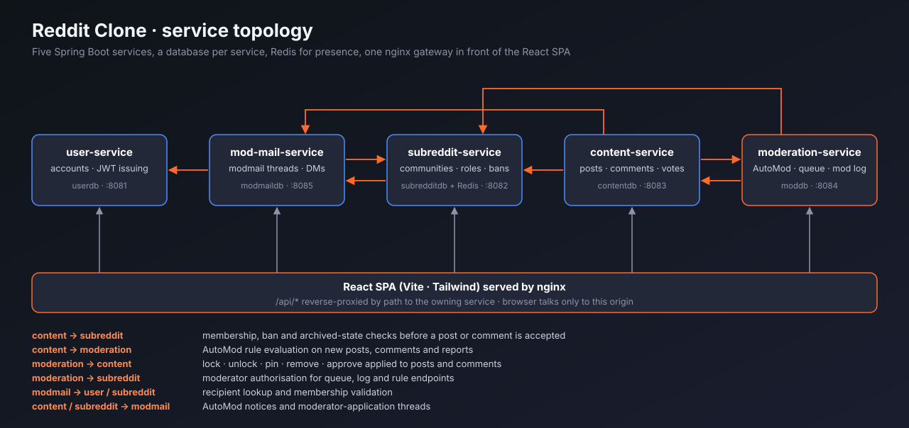

# Reddit Clone

A Reddit-style community platform built as a set of cooperating Spring Boot services behind a React front end. Communities, posts, threaded comments and voting are the base. The interesting part is the moderation stack on top: an AutoModerator rule engine, a mod queue, an audit log, bans, and modmail, each of which lives in its own service and has to coordinate with the others over HTTP.



This is a fork of [nothing-reasonable/Reddit-Clone](https://github.com/nothing-reasonable/Reddit-Clone), a team project. The architecture and most of the codebase are Tanvir Liaquat Uday's. See [Contributors](#contributors) for who built what, and [My contributions](#my-contributions) for my part.

## What it does

**Communities**
- Create and join communities (public, restricted or private) with rules and moderator roles
- Moderator applications and ownership takeover requests
- Live "online now" counter per community, backed by Redis

**Posts and comments**
- Text, link and image posts, threaded comments, up/down voting, saved posts
- Locked and pinned posts, and a removal flow that hides content from regular users
- Search across communities

**Moderation**
- **AutoModerator**: write rules in YAML (title/body/author/report-count conditions, remove / flag / approve / lock / modmail actions), with per-rule edit history and an action log. Rules apply to posts and comments.
- **Test playground**: dry-run a rule, or all saved rules, against a sample post before turning it on
- **Mod queue**: flagged and reported items with approve/remove, plus per-user report tracking
- **Mod log**: every moderator and AutoMod action, paginated and filterable
- **Bans**: per-community, enforced when someone tries to post or comment
- **Modmail and DMs**: threaded moderator conversations (AutoMod can open one), plus direct messages between users

## Architecture

| Service | Port | Owns | Notes |
|---|---|---|---|
| `user-service` | 8081 | accounts, credentials | issues the JWTs |
| `subreddit-service` | 8082 | communities, members, roles, rules, bans | Redis for presence |
| `content-service` | 8083 | posts, comments, votes, saved posts | calls subreddit, moderation, modmail |
| `moderation-service` | 8084 | AutoMod rules and engine, mod queue, mod log | calls content and subreddit |
| `mod-mail-service` | 8085 | modmail threads, direct messages | calls user and subreddit |
| `ui` | 5173 | React SPA served by nginx | reverse-proxies `/api/*` by path |

Each service has its own PostgreSQL database and shares nothing with the others except the JWT signing secret, so a token issued by `user-service` is accepted everywhere. Service-to-service calls are synchronous REST (`RestClient`) on a private Docker network; only nginx is exposed to the browser.

A few design points worth knowing:

- **Cross-service rules are enforced at the write path.** `content-service` asks `subreddit-service` about membership, bans and archived state before it accepts a post or comment, and asks `moderation-service` to evaluate AutoMod rules on new content.
- **Moderator actions round-trip.** A lock/remove/approve in `moderation-service` is applied to content through an internal endpoint on `content-service`, then written to the mod log.
- **Presence uses a Redis sorted set** keyed per community with timestamps as scores. Stale members are pruned on read, so there is no cleanup job.
- **The AutoMod engine has no database or network access.** `AutoModEngine` only evaluates a rule against a context object, which is what makes the test playground and the unit tests simple.

## Tech stack

Java 25, Spring Boot 4, Spring Security (JWT), Spring Data JPA, PostgreSQL 16, Redis, React 18, TypeScript, Vite, Tailwind CSS 4, Radix UI, nginx, Docker Compose, GitHub Actions.

## Running it

Requires Docker with Compose.

```bash
git clone git@github.com:Morningstaaar36/Reddit-Clone.git
cd Reddit-Clone
docker compose up --build
```

The first build downloads Maven and npm dependencies and takes a few minutes. Then open <http://localhost:5173>, sign up, create a community, and you are its moderator.

The services use a development JWT secret by default. To change it, set `JWT_SECRET` to the same value on every service.

To run a service outside Docker, start the databases and Redis from `docker-compose.yml`, then:

```bash
cd moderation-service && ./mvnw spring-boot:run
```

Database ports on the host are 5432 (user), 5433 (subreddit), 5434 (content), 5435 (modmail) and 5436 (moderation). For the front end, `cd ui && npm install && npm run dev`.

## Tests and API reference

```bash
cd moderation-service && ./mvnw test
```

The unit tests cover the AutoMod engine and the test playground. The full REST surface is described in [`references/apidoc.yaml`](references/apidoc.yaml) (OpenAPI 3), and the AutoMod and mod queue behaviour the rules engine is modelled on is written up in `references/`.

## Project layout

```
user-service/        accounts and JWT issuing
subreddit-service/   communities, membership, bans, presence
content-service/     posts, comments, votes
moderation-service/  AutoMod engine, mod queue, mod log, test playground
mod-mail/            modmail and direct messages
ui/                  React front end and nginx config
references/          API spec and AutoMod / mod queue reference notes
docs/                diagrams
```

## Contributors

Built by a team of BUET students between March and April 2026.

- **Tanvir Liaquat Uday** ([@nothing-reasonable](https://github.com/nothing-reasonable)): original author. Designed the service split, wrote the bulk of the backend, the AutoMod engine foundation, modmail, Docker setup, and most of the integration work.
- **usaben**: report-based AutoMod rules, comment reports, auto-flag filtering, AutoMod logs and history
- **RedWine356**: reporting fixes, nginx and CORS configuration for deployment, CI/CD pipeline
- **Tasnimul Islam Mahi** (also committing as Mahi2105013): AutoMod action logs, rule edit history, AutoMod on comments, moderator comment removal
- **Shahraz Hussain Siyam**: initial UI scaffold
- **Phoenix**: refactor of modmail into general user-to-user messaging
- **Morningstaaar36** (me): see below

## My contributions

I joined the project after the core services were in place and worked on the moderation and trust-and-safety side. Everything below is in the commit history under `git log --author=Morningstaaar36`.

**Moderator actions on content.** Built lock, unlock, pin, unpin, remove and approve for posts end to end: the endpoints in `moderation-service`, the internal endpoints on `content-service` that apply them, and the mod log entries.

**Community bans across services.** Added per-community bans to `subreddit-service` (model, repository, endpoints, ban list UI) and wired `content-service` to check them through a new `SubredditClient.isBanned` call before accepting a post or a comment. The ban check is best-effort and fails open if `subreddit-service` cannot be reached.

**Authorization fix.** Any authenticated user could update or delete any community. Both operations now require the caller to be a moderator of that community, checked in the service layer.

**Correctness fixes found while testing the moderation flow:**
- Mod log pagination always returned the first page
- Removed comments still exposed their original text through the API
- Comment counts were not decremented when a moderator removed a comment
- Deleted posts could still be voted on and commented on
- A set of smaller UI and API fixes around the post detail view and moderation API client

**Housekeeping for this fork:** made the JWT secret overridable through `JWT_SECRET` instead of hardcoded in every service, made the deploy workflow manual and secret-driven instead of pushing to a fixed host on every commit, and replaced the outdated startup notes with this README.

## Credits

Original project by [Tanvir Liaquat Uday](https://github.com/nothing-reasonable/Reddit-Clone) and the contributors listed above. UI components are from [shadcn/ui](https://ui.shadcn.com/) (MIT); see [`ui/ATTRIBUTIONS.md`](ui/ATTRIBUTIONS.md).
